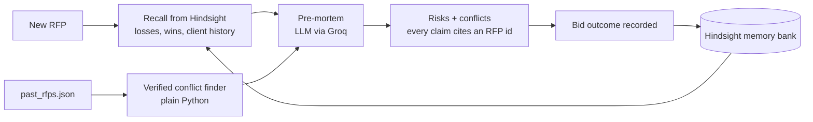

# MEMORA

**An RFP agent that remembers why you won and why you lost.**

> **Status:** the backend pipeline (ingest → recall → pre-mortem → verified conflict detection) runs end to end and is demonstrated below with real output. The learning-loop demo and the web interface are not yet built — see Roadmap.

<!--  -->
<!-- Add a screenshot of a real agent.py run here before submission. -->

Every sales team has the same problem with proposals. The answer to "why did we lose that healthcare deal?" lives in someone's head, or in a folder nobody opens. So the next bid repeats the same mistake.

MEMORA gives the bid team a memory. Before anyone writes a response to a new RFP, it runs a **pre-mortem**: the most likely ways this bid will fail, each one tied to a real past bid.

---

## The problem a search box can't solve

Two healthcare bids from the sample data:

| Bid | Approach | Result | Why |
|---|---|---|---|
| RFP-003, Meridian Valley Health System | Security-first | Won | The client's go-live date was flexible, so a long security review didn't hurt |
| RFP-011, Cedar Ridge Medical Group | Security-first | Lost | A competitor promised a secure core in 90 days; our seven-month plan missed the opening date |

Same approach, opposite outcome. A keyword or vector search returns both records and leaves you to work it out. MEMORA surfaces the contradiction and names the factor that decided it.

From an actual MEMORA run against a new healthcare RFP with a hard 90-day go-live (see `docs/run4.txt` for the full transcript):

> **Claim:** A security-first approach guarantees a win.
> **For:** RFP-003. **Against:** RFP-011.
> **Deciding factor:** RFP-003 had a flexible timeline, so a thorough security review became a differentiator. RFP-011 required a 90-day core, and a seven-month security-focused plan could not meet it.

---

## How it works



1. **Ingest.** Each past RFP is written into a Hindsight memory bank. Every sentence states the approach and the outcome together, so the two can't be separated when facts are extracted.
2. **Recall.** For a new RFP, several targeted queries pull the relevant losses, wins and client concerns.
3. **Label.** Each recalled memory is tagged with its real RFP id, looked up from the source data. The model is told to cite only tagged memories.
4. **Pre-mortem.** The model returns structured risks and conflicts as JSON. Every claim must cite a real bid.
5. **Learn.** When a new bid closes, `record_outcome()` writes the result and the reason back into memory, so the next pre-mortem knows about it.

---

## Where Hindsight fits, and what it changes

Hindsight is the memory layer, not a feature bolted on.

- **`retain`** stores every past bid, and every new outcome, in a persistent bank. Ingest uses the RFP id as the document id with replace mode, so re-running it never creates duplicates.
- **`recall`** retrieves the memories relevant to a new RFP.
- **`reflect`** synthesises a strategy view across many bids (see `get_strategy()` in `backend/memory.py`).

Without the memory layer, the agent has no history and produces a generic proposal outline. With it, the output is specific: which bids to worry about, what went wrong, and what the client cared about.

---

## Design decisions worth explaining

**Approach and outcome live in the same sentence.** Hindsight extracts facts sentence by sentence. Early versions wrote the strategy in one sentence and the result in another, and recall returned fragments that had lost the link between them. Rewriting the text so each sentence carries both fixed that.

**Citations come from data, not from the model's memory of the text.** Extracted facts often drop the bid id. So each recalled memory is labelled by matching the client name against the source records, and the prompt forbids citing anything unlabelled. In test runs this removed wrong citations entirely, and the check for invented ids stays empty.

**The headline conflict is found in plain Python.** Recall sometimes returns the security-first fact from RFP-011 with no client attached, and the prompt correctly refuses to use it as evidence. That is a real limitation of matching paraphrased facts. So `_known_conflicts()` scans the source data directly for approaches that both won and lost, and hands the verified pairing to the model to explain. The model explains the difference; it doesn't have to discover it.

---

## Run it

**Requirements:** Python 3.11, a Hindsight Cloud account or a self-hosted [Hindsight](https://github.com/vectorize-io/hindsight) instance, and a Groq API key.

```bash
python -m venv .venv
.venv\Scripts\activate          # Windows
pip install -r requirements.txt
```

Create a `.env` file:

```
HINDSIGHT_BASE_URL=https://api.hindsight.vectorize.io
HINDSIGHT_API_KEY=your_key
GROQ_API_KEY=your_key
```

Load the sample history, then run a pre-mortem:

```bash
python backend/memory.py ingest
python backend/agent.py
```

The last command prints a summary (errors, invented ids, cited evidence, conflicts) followed by the full JSON. The default test bid is a mid-market healthcare intake and billing platform with a hard 90-day go-live.

---

## Project layout

```
backend/
  memory.py       Hindsight client, ingest, strategy reflection
  agent.py        recall, labelling, conflict finder, pre-mortem, outcome recording
  verify.py       quick recall checks for losses, wins and client priorities
data/
  past_rfps.json  23 synthetic RFPs across healthcare, finance, retail, logistics and more
docs/             saved pre-mortem runs and recall experiments
frontend/         interface (in progress)
tests/
```

---

## The data

The 23 RFPs in `data/past_rfps.json` are synthetic. Each has a client, industry, size, deal value, requirements, priorities, concerns, the strategy used, the outcome and the stated reason. They were written to contain real tensions: the same tactic winning in one place and losing in another.

Three such pairs are currently detected by `_known_conflicts()`, confirmed against the saved run in `docs/run4.txt`:

| Approach | Won | Lost |
|---|---|---|
| Security-first | RFP-003, Meridian Valley Health System | RFP-011, Cedar Ridge Medical Group |
| 24/7 support bundled into base price | RFP-022, Coastline Distribution Group | RFP-015, Ironwood Cargo Lines |
| Premium pricing with an ROI model | RFP-007, Ashford & Lyle Consulting Group | RFP-020, Thornbury Advisory Partners |

This table is regenerated by re-running `python backend/agent.py` and updating `docs/run4.txt` — it is not a description of intended behavior, it is a report of the last verified one.

---

## Known limitations

- Recall is paraphrased. Extracted facts can lose the client name, which is why citations are anchored to source data.
- The conflict finder uses keyword tags for approaches. It is deterministic and easy to audit, but it only finds tactics it has a keyword for.
- The dataset is synthetic and small. Behaviour on messy real-world proposals is untested.
- The interface is not finished. The pipeline runs from the command line.

---

## Roadmap

Not yet built. Listed here rather than in the sections above because nothing below has a saved run or transcript backing it yet:

- **Point each conflict to the bid that resolved it.** In the data, RFP-019 won a healthcare deal with a security-first plan by delivering a secure core in 60 days — exactly what RFP-011 lacked. `_known_conflicts()` currently stops at naming the contradiction; extending it to name the resolution is the next change.
- **Learning-curve demo.** Hold RFP-011 out of a separate memory bank, run a pre-mortem (timeline risk should be absent or weak), record the outcome, run it again, and show the warning appear citing RFP-011.
- **Proposal drafting** that cites the bids it draws from.
- **A web interface** showing the recalled memories, the conflict table, and the pre-mortem side by side.

Each of these gets promoted out of this section and into the body once there's a saved run in `docs/` to point to — the same standard the rest of this README holds itself to.

---

## Links

- [Hindsight on GitHub](https://github.com/vectorize-io/hindsight)
- [Hindsight documentation](https://hindsight.vectorize.io/)
- [What is agent memory](https://vectorize.io/what-is-agent-memory)
